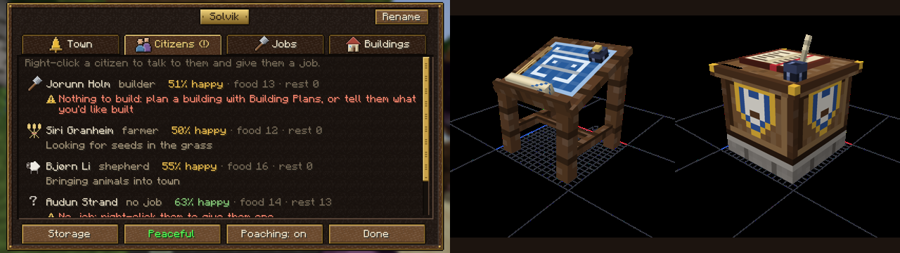
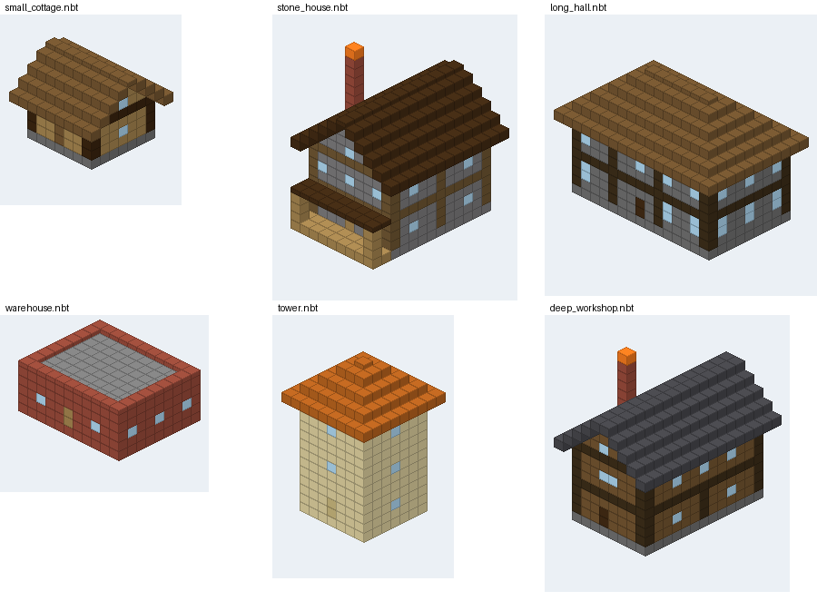
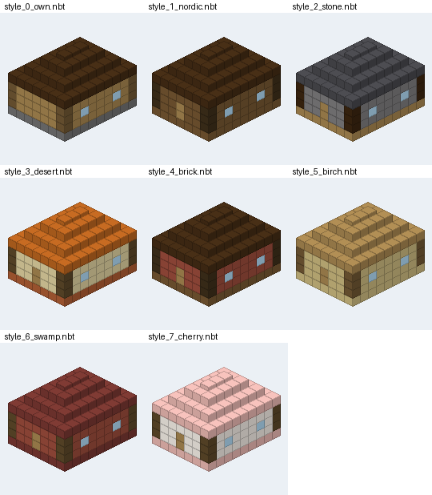

# Stad

A NeoForge 1.21.1 mod: **build a town with citizens who live, work, love, gossip and remember**, like MineColonies
meets Minecraft Comes Alive, except every citizen is run by a small local AI you can talk to, by typing or with your
voice. Give them homes and jobs, plan buildings with your builder in plain words ("a small stone cottage with two
bedrooms and a chimney"), and lead them well, or they'll refuse your orders, strike, or move to a rival's town.

Talking, memory, voices and the AI runtime come from [They Will Talk](https://github.com/Eiriksb/they-will-talk),
which Stad requires. Everything runs locally on your own GPU. No cloud, no API keys.



> **Status:** 0.1.0, the first release (all eleven milestones of [PLAN.md](PLAN.md) done). New players: start with the
> [guide](docs/GUIDE.md); what's in this release is in the [changelog](CHANGELOG.md).
>
> Found a town with a **town hall**; newcomers move in when there
> are free beds. Citizens sleep in their own beds, eat from the town hall, plan their day each morning (in character,
> with the local AI), spend evenings with friends (passing news along), court, marry and have children who grow up.
> Give them jobs from their card (right-click): **builder**, **farmer**, **lumberjack**, **courier**, **guard**, **cook**,
> **fisher**, **shepherd**, **miner**, **smith**, **healer**, **merchant**, **teacher**, **carpenter**, **mason**,
> **weaver**, **beekeeper** and **gatherer**.
> **Plan buildings by talking to your builder**: "a small stone cottage with two bedrooms, a spruce roof and a
> chimney". They draw it up (restyling one of the pack's buildings when it fits, or designing a new one: framing,
> rooms, stairs, furniture, gable, hip or flat roofs, porches, chimneys), a see-through ghost of it appears on free
> land nearby with what it takes, and you change it as you talk ("make it two floors", "use dark oak for the roof",
"put it next to the builder's hut", "facing the lake") until you say "build it". Keep designs you like in **My pack**.
> **Make the town your own**: stand in a house you built and tell a citizen "this is your home now"; they look round
> and move in, or tell you what's missing ("I'd need a bed in here"). Scan your buildings into My pack with the
> **scan wand**, fix what the game guessed about their blocks, and build any pack building in another **style**
> (Nordic, Desert, Stone, Brick...). When the builder runs out of spruce they ask before using birch instead.
> **Defend it**: raiders that fit the land (Norse raiders, marauders, bandits or pillagers) come for bigger towns at dusk; someone spots them and shouts a warning, guards fight, the rest
> shelter, and the builders repair the damage afterwards. Towns that choose to be **open to war** can raid each other
> (with warnings, raid windows and a banner to take at the town hall), lure away each other's unhappy citizens, and
> make peace through envoys who argue for it in character.
> **Lead them well**: your standing with the town rises and falls with how they're fed, housed and treated (and with
> what they make of your conversations). A respected leader is obeyed; a doubted one gets grudging, slower work; a
> resented one hears "no", with a reason, or "only once I've eaten". Miserable citizens leave, and an unhappy town
> goes on strike. Players have ranks, and every order is checked and logged. The design and roadmap are in
> [PLAN.md](PLAN.md).

### Talking to citizens

Right-click a citizen to talk to them face to face: the chat screen shows who they are (job, town, age, home), how
they're doing, what they think of you, and what you've said to each other. Type to them there, or speak with your
voice chat key while looking at them (spoken lines and their replies show up in the screen too). It also has buttons
for the orders you may give (a job, the house you're standing in, inviting them, asking them to leave) and, for the
builder, a shortcut to plan a building.

Every citizen has their **own voice**, from their genes and age: a pitch, a pace, a timbre and a family way of speaking,
passed on to their children, so families sound alike. A child's voice changes as they grow up; otherwise it stays the
same, whatever their job or town. (With They Will Talk's designed voices, each is described in words, like "A young
woman in her twenties with a medium-pitched, crisp voice and a gentle sing-song cadence"; `/stad citizen voice` shows
them.) When you talk to the builder aloud, they keep it short and leave the lists to the screen.

### Jobs and food

| Job | Works | Needs |
|---|---|---|
| Builder | builds what officers plan, what it can while waiting for the rest; makes up the ground under it | the materials in the town hall (or a warehouse) |
| Farmer | makes fields (marks one out, levels and tills it round a water hole it digs), sows, harvests and replants | seeds in the town hall (or picked from the grass), flat grass or dirt |
| Lumberjack | fells natural trees and replants; plants a grove when there are none | trees, or saplings in the town hall |
| Courier | carries food and materials to the town hall and the builder; keeps the warehouse's shelves in order and makes room in a full town hall | a warehouse |
| Guard | patrols and fights, trained (30 health, harder blows) | a sword from the town's stores |
| Cook | bread from wheat; cooked meat, fish and potatoes, to the town hall | a furnace, smoker or campfire |
| Fisher | fishes from the shore (the game's fishing loot) | a pond or river |
| Shepherd | brings in animals from just outside town, shears, breeds up to `herdSize` of each kind, butchers the extras | farm animals in or near town (named or leashed ones are pets) |
| Miner | digs a 5x5 shaft down to bedrock, layer by layer, down a spiral of steps; strip-mines tunnels out from it at the ore levels and digs out the veins it finds; walls off water and lava | a mine (Medieval pack, or design one at the table) or a quarry |
| Smith | makes the tools the workers are short of (and swords), mends worn tools, smelts ore | a smithy (an anvil and a furnace) |
| Healer | goes round treating the ill and the wounded | nothing (an infirmary gives the ill a bed) |
| Merchant | keeps the market: players trade with the town through them, for emeralds | nothing (a market to stand at) |
| Teacher | teaches the town's children at the school | a school (a lectern) |
| Carpenter | saws logs into planks and sticks; makes the doors, fences, stairs and chests the builders are short of | a sawmill (a crafting table), logs, an axe |
| Mason | burns cobblestone into stone, cuts stone bricks, slabs and stairs, makes glass from sand | a stoneworks (a stonecutter and a furnace), a pickaxe |
| Weaver | makes wool into beds for new homes, and carpets | a loom house (a loom), wool and planks, shears |
| Beekeeper | brings bees to the hives, sows flowers for them, takes honey (into glass bottles) and honeycomb | an apiary (lay one out at the architect's table), shears |
| Gatherer | digs dirt, sand, gravel and clay off the top of the land round the town, forages berries, sugar cane, seeds and flowers, picks up what's lying about | nothing (a shovel makes it quicker) |

All of it happens on the town's land. **Every citizen says what they're doing, or what's stopping them and what would
fix it**, on their card and in the town hall's Citizens tab; the Jobs tab says what each job needs and whether the town
has it, and the Town tab lists the next steps in getting a town going. Hover over a job on a citizen's card for the
same. A problem that lasts is told to the town's leaders in chat, once a day. Wheat only feeds anyone once a cook bakes it, and cooked food fills far more than
raw, so a farmer and a cook keep a small town fed.

**Workplaces.** Every job has a building it works from: farmers a **farmhouse** (a composter and a chest), lumberjacks a
**lumber camp** (a chest and a crafting table), fishers a **fishery** (a barrel), shepherds a **barn** (a loom and a hay
bale), cooks the kitchen, miners the mine, builders the builder's hut, couriers the warehouse, guards the barracks or a
watchtower. Each pack has a farmhouse, lumber camp, fishery and barn of its own, and the architect's table can draw
them up (it puts in the composter, barrel, loom or hay a generated one lacks, and says whether there's farmland, trees,
water or a pen round the site). A workplace has room for one worker per work marker, or per job block (composter,
barrel, loom, furnace, bed...), up to four. Workers are put in the nearest one of their kind with room; move them with
"work at the lakeside fishery" (or "work here", standing in it), or `/stad citizen workplace`. A worker with a
workplace goes there first thing in the morning, works the land round it (farmers the fields round their farmhouse,
lumberjacks the trees round their camp, fishers the nearest shore), works a quarter faster and is happier; when the
town has a courier they take their haul in there, and the courier carries it on to the warehouse or the town hall.
Without one they work as before, but grumble about it after a day or two (it costs you a little standing). The town
hall screen shows who works where. The later jobs have theirs too: the **smithy** (an anvil, a furnace or blast furnace,
a chest), **infirmary** (a brewing stand and a bed), **market** (a bell and a chest) and **school** (a lectern), with a
design of each in every pack.

**Skills.** Citizens get better at a job by doing it: ten levels from novice to master, each 2% quicker. The level
is on their card and in what they say, and every job keeps its own (a farmer who turns smith starts as a novice smith,
but is still a skilled farmer).

**Tools.** Farmers need a hoe, lumberjacks an axe, miners a pickaxe, fishers a rod and shepherds shears, and they're
real: a worker takes the best one from their workplace or the town's stores, wears it out, and puts it back in their
workplace at night. Without one they make do, a third slower, and the town asks for one. The **smith** makes what the
workers are short of from the game's own recipes and what's in the stores (an iron one when there's iron, else stone
or wood; sticks from planks if it has to), mends worn tools at the anvil with their own material, and smelts the
miner's raw ore into ingots.

**Illness.** Now and then a citizen falls ill (more often when hungry or homeless; `needs.illnessChance`). They stay in
bed (an infirmary's, if there's one free), don't work and are less happy; it passes in three days, or after two of the
healer's treatments. The healer also mends the wounded, three hearts a treatment.

**The market.** The town's money is emeralds in its stores. Its merchant sells what the town has more of than it keeps
(over 64 of most things, more of food for a big town) and buys what it's asked for, in the game's trading screen
(**Trade** on the merchant's card, or sneak and right-click them). Every trade moves the goods in and out of the town's
real chests. Tools, weapons and armour aren't for sale.

**School.** While the teacher is at the school, the town's children go there by day. Each school day adds to a child's
schooling (up to ten); grown up, schooling makes them learn any job up to twice as fast.

### Talking a building through

Talk to the town's builder (typing or by voice) about what you'd like built. Behind the scenes two quick calls to the
local model sort out what you mean (a new design, a change, "build it", "move it", "keep it") and fill in a building
spec; the game turns the spec into blocks, so every design is buildable. Under the draft in chat there are buttons
for the same things: **Build it**, **Move here** (where you're looking), **Turn**, **Save** and **Drop**. Building it
is an order like any other: it needs an officer, and a builder who doesn't trust you may refuse.



(`tools/iso.py` draws structure files like this; the game tests write their sample houses to `run/gametest/stad-designs/`.)

**My pack** is an ordinary data pack in your world (`datapacks/stad_my_pack`): saved designs show up in the Building
Plans and can be copied to other worlds like any data pack.

### Your own buildings

**Adopting a house.** Stand inside a building you made and tell a citizen "this is your home now" (or "this is your
workshop", "...your warehouse"), or use `/stad adopt`. The game fills the rooms from where you stand: doors that lead
outside are the way in, gaps in the walls and open sky inside are reported, and what's in there is counted. A home
needs walls, a roof, a door and a bed; a builder's hut a crafting table, a chest and a bed; a warehouse four chests or
barrels; a workshop a crafting table and a workstation. If it has them it becomes one of the town's buildings, as it
stands, and the citizen moves in (an order like any other: a resented leader may hear "no"). If not, they tell you
what's missing.

**The scan wand** (an amethyst shard on top of two sticks): left-click one corner of a building, right-click the
opposite one, then sneak and use it. The **pack editor** opens: name it, say what kind of building it is, and check
what each kind of block is for. The game guesses every block's role (floor, walls, frame, roof, trim, windows, doors,
lights, furniture, decoration) from its shape and where it sits; click a row to fix a wrong guess. Save, and it's in
My pack and the Building Plans, turned so its door faces north like every pack building. Vanilla structure blocks in
Data mode with `stad:storage`, `stad:work`, `stad:sit`, `stad:bed`, `stad:door` or `stad:shaft` as their metadata are kept
as markers (with storage markers, only the chests next to them count as the town's; `stad:shaft` is the middle of a
mine's shaft).

**The architect's table** (Building Plans on top of a cartography table) is for designing a building for exactly
this piece of land. Mark the site's corners with the scan wand and right-click the table with it (or type the
corners into the table's screen): at most 32 by 32 blocks and 32 high, on the town's land. The table shows the site in
3D with the land round it (drag to turn, scroll to zoom, middle-drag to pan, shift+scroll or Page Up/Down to cut the
view off at a layer and look inside). The view takes up the screen: the building's name and kind (any of them: home,
builder's hut, warehouse, barracks, watchtower, kitchen, mine, workshop and the workplaces) are top left, and the
tools are along the bottom: place, break, pick, box, walls, floor, line, replace, copy and paste, markers, mirroring
and undo, with a searchable list of every block a survival player can place (and what the town has of each). The line
bottom left says what it still needs to be that kind of building. **Generate ▾** opens a drawer to start from a
generated building: a style, floors, roof, door, beds and extras, and **Generate** fills the site with one that fits,
standing on the ground with a foundation where the land falls away. Your own changes stay on top when you generate
again; **Flatten** makes it all plain blocks, and **Ask** has the planner model revise it from what you write ("add a
porch and make the roof hip"). The drawer also has **Change site** and **Reset**. **Save** keeps the design in My pack;
**Plan it here** plans it on the site for the builders (what the design leaves out of the site stays as it is; a
finished building on the site is redesigned in place). Officers edit; other members can watch. Broken, the table keeps
its project.

**Land for every job that works the land.** Besides homes and a workplace for every job, the kind list has land:
a **quarry** for the miner (an open pit dug 8 to 64 layers down, or to bedrock, with steps round its edge), a **dock** for the fisher
(a pier with spots to fish from), a **guard post** (a platform the guards climb and keep watch from) and a **wall**
(logs, stone bricks or cobblestone round the site, with a door and watch spots for the guards; it may go round what's
already there), a **market square** (stalls round a paved square with a bell; a merchant keeps each stall) and
**roads** (routed between the doors in the site, drawn by hand with the Road tool, or laid for the whole town at once
with **Lay roads** at the town hall; citizens walk faster on them),
as well as fields, pens and groves. Pick **Field**, **Pen** or **Grove** as the kind and open
**Lay out ▾**. A field is farmland round water channels or holes (every plot within four blocks of water), sown with a
crop or mixed strips, with a fence, a path round the inside and lamps if you like. A pen is a fenced yard with a gate,
for sheep, cows, pigs or chickens, with a shelter, a hay bale and a cauldron of water. A grove is saplings of one kind
(or mixed) in rows three to six blocks apart, with a path through it. Change them by hand like a building (water and
crops can be placed in designs); the checklist says whether every plot has water, the fence shuts the animals in and
the saplings have room. Planned, the builders level the ground and put up the fence, path and shelter, and the land is
the workers': the farmer digs the water, tills and sows each plot with its crop, the lumberjack plants each spot with
its sapling and fells the trees, and the shepherd leads the animals in through the gate.

**Build in it** (top right) takes you to the drafting world to build it yourself, in creative: an empty void with a
copy of the site, the design and the land round it, as the table shows it, in the real place's biomes (so the grass,
leaves and water are the right colour), always lit and with no weather. A grid with a yellow edge marks the site:
that's where you can build. Fly, take any block, break at a touch; only the site itself can be changed, and an
invisible box keeps you near it. Press **B** (or click **Done** in chat, or
`/stad build done`) and **Keep it**: what you built becomes the table's design (on top of the generated building, like
hand edits), you're back where you were with your own inventory and game mode, and the table opens to show it. **Throw
away** (or **Cancel**) leaves the design as it was. The real site is never touched, and nothing comes back with you:
your inventory is saved with the world before you go, and you can't open containers or ender chests, use items that
aren't blocks or touch entities there. The drafting world keeps your copy, so logging out or a restart doesn't end it.

**Styles.** A palette gives the roles new materials, so any pack building can be built in another style: pick one in
the Building Plans, say it to the builder ("in the Nordic style"), or `/stad colony plan <building> <style>`. The mod
brings seven; add your own as `data/<namespace>/stad/palettes/<id>.json`:

```json
{ "name": "Nordic", "description": "Dark timber and steep dark roofs.",
  "walls": "spruce", "frame": "dark_oak", "roof": "dark_oak", "floor": "spruce", "trim": "cobblestone" }
```



**Packs.** Besides Medieval (timber and cobblestone under hip roofs) the mod brings **Oasis** (sandstone with flat
roofs and parapets). Both have a home, a builder's hut, warehouses and every job's workplace.

**Making do.** When the builder runs out of a material and the town has enough of a similar one (another wood for
wood, another stone for stone), they ask before swapping: "We're out of oak. Shall I use birch for the walls?" Say
yes or no to them, or click the buttons in chat.

**Sharing packs.** `/stad pack export [name]` zips My pack into `stad/exports/`. It's a data pack: drop it in a
world's `datapacks` folder, or in `stadpacks/` in the game folder to have it in every world.

### Raids and rivalry

**Guards** patrol between the town hall, watchtowers and barracks, and fight monsters on the town's land and raiders.
They take the best sword and armour from the town's stores (and the town asks for a sword when there's none). Brave
sorts (boastful or dramatic citizens) pick up a weapon when their town is attacked.

**Mob raids.** Now and then at dusk raiders come for a town that's big enough (four citizens, by default). Who comes
depends on the land round the town hall: **Norse raiders** (iron helmets and axes) in taiga and snowy lands,
**marauders** (sand-coloured leathers, golden swords and bows) in deserts, badlands and savanna, and **bandits** (dark
leathers, swords and bows) or the game's **pillagers** elsewhere. Every raid but the pillagers' has a named leader,
tougher and better armoured than the rest ("Ivar Ironside and 5 Norse raiders are attacking Ashford from the
north!"). A citizen spots them and shouts which way they're coming from, a horn sounds, and a minute later they
arrive: more for bigger, richer towns (`maxRaiders` at most). Guards fight; everyone else shelters indoors, or runs to
the far side of town when there's nowhere to hide. Afterwards the whole town remembers it ("Hild killed four
of them"), your standing rises if you saw them through it (and drops if you weren't there), and anything broken
becomes a repair order the builders do first. `mobRaids` in the config: off, easy, normal or hard.

**Your land is protected.** Only a town's people can build, dig, or open chests and beds on its land.

**War is opt-in.** Every town starts **peaceful** and can't be attacked by players. Its founder can make it **open to
war** at the town hall (going back takes three real days, and never during a war). Two open towns can go to war:
- An officer declares it; both towns hear (and the citizens have opinions: bold sorts like it, peaceful ones and those
  with family over there don't, and that shows in your standing). After a warning period (24 real hours), one raid can
  start, inside the defenders' raid window (18:00 to 22:00 server time by default; `/stad war window`) and only while
  one of their officers is online.
- An officer leads the raid from the defenders' land; their guards are ordered to march (and may refuse a leader they
  resent). To win, hold the ground by the defenders' town hall for 60 seconds with no defender near: the banner is
  taken, a fifth of their stock (at most 512 items) is carried off, and unhappy citizens may go over to the winners.
  Defenders win by holding out for 20 minutes. During a raid attackers can break doors, fences, walls and gates and
  nothing else; beds, chests and the town hall stay locked. Killing someone who wasn't fighting is remembered on both
  sides and costs a lot of standing.
- It ends in a truce (three real days). Either side can offer peace (`/stad war peace`), or send a citizen as an
  **envoy**: they wait at the other town hall, make the case for peace in character, and an officer there can say
  "we accept" or send them home.

**Poaching.** An officer of one town can invite another town's citizen: if they're unhappy where they are, they may
come. Each town can switch this off (the town hall has a button for it and for the war stance).

`pvpRaids` in the config: off, opt_in (the default) or forced (every town can be attacked). The warning, cooldown,
truce, raid length, capture time, loot share and offline raids are all settings too.

### Big towns and hosting

Stad is tuned for towns of 50 and more. Citizens near a player (`thinkRadius`, 48 blocks) plan their day with the
local AI each morning, one or two at a time while it isn't busy and at most `plansPerDay` (16) a town; everyone else
follows their routine (their job, their needs, now and then an afternoon off), which costs nothing. Conversations
always go first. On the dev machine (Ryzen 7 9800X3D) a town of 125 working citizens costs the server about 3 ms per
tick of its 50 (`/stad perf` shows where the time goes). A town's land stays loaded while one of its members is online
(`keepLoaded`: never, while_online or always; `loadedRadius` chunks round the town hall), so builders keep building
while you're off mining. Crops only grow near players, as in vanilla. Mob raids are capped at `maxRaiders` (16).

Hosting without a big GPU:
* **A planner model.** Building designs can use a bigger model than the chat (*Use for planning* on They Will Talk's
  Models page). It only runs while someone is planning, then frees the GPU again.
* **Lent GPUs.** Players with They Will Talk on their own computer can type `/lendgpu on`: the citizens they talk to
  then think on their GPU (only their own conversations are sent). A server with no GPU at all runs on lent ones;
  players who don't lend get "can't talk right now" while nobody's lending to it (their towns still live and work).
* **Your own model server.** `externalLlmUrl` in They Will Talk's config points at Ollama, LM Studio or llama.cpp elsewhere.

### Building packs

A pack is part of a data pack: a manifest per building in `data/<namespace>/stad/buildings/<pack>/<building>.json`
naming a vanilla structure template (`data/<namespace>/structure/...nbt`, saved with a structure block, front door
facing north). See `data/stad/stad/buildings/medieval/` and `tools/packgen.py`, which generates the bundled pack.

```json
{ "type": "stad:home", "name": "Cottage", "description": "A cozy home with two beds.",
  "structure": "stad:medieval/cottage", "tags": ["small", "home"],
  "roles": [{ "block": "minecraft:oak_planks", "from": "wall", "to": "trim" }] }
```

`roles` (optional) corrects the guessed block roles, as the pack editor does.

### Commands

| Command | |
|---|---|
| `/stad colony info` | the town you're in (or lead): citizens, beds, ranks |
| `/stad colony rename <name>` | officers |
| `/stad colony rank <player> <owner\|officer\|member\|visitor>` | the founder |
| `/stad colony dissolve` | the founder (or an admin) ends the town |
| `/stad colony builds` | planned buildings and how they're going |
| `/stad colony requests` | what the town needs, and where |
| `/stad colony standing` | how the town sees you as a leader, and why |
| `/stad colony setstanding <player> <value>` | admins, for testing |
| `/stad colony plan <building> [style]` | officers: plan a building in front of you (what the Building Plans do) |
| `/stad colony cancel <id>` | officers |
| `/stad citizen job <uuid> <builder\|farmer\|lumberjack\|courier\|guard\|none>` | officers (the citizen card has buttons for it) |
| `/stad citizen workplace <uuid> <building id>` | officers: where a worker works from (ids as in `/stad colony builds`) |
| `/stad citizen trade <uuid>` | trade with a merchant you're standing by |
| `/stad build done` / `cancel` | end free build in the drafting world, keeping what you built as the design or not |
| `/stad draft show` | your draft building: what it is and where (and its buttons again) |
| `/stad draft approve` / `here` / `turn` / `save` / `cancel` | what the buttons under a draft do |
| `/stad draft describe <text>` | draw up a building from a description without talking (asks the local model) |
| `/stad draft spec <json>` | draw up a building from a spec (see `planner/BuildSpec.java`) |
| `/stad draft style <style>` | your draft in a style's materials |
| `/stad adopt` / `adopt as <kind> [name]` | officers: the building you're standing in becomes the town's |
| `/stad adopt check [kind]` | what it has, and what it's missing to be a home, workshop... |
| `/stad adopt give <uuid>` / `release <id>` | give the house you're in to a citizen; let a taken-over building go |
| `/stad scan pos1` / `pos2 [pos]` / `open` / `save <name>` / `clear` | the scan wand, as commands |
| `/stad pack list` / `palettes` | the buildings and styles that are loaded |
| `/stad pack edit <building>` / `delete <building>` | open a building in the pack editor; delete one of My pack's |
| `/stad pack role <building> <block> <guessed> <role>` | fix a guessed block role |
| `/stad pack export [name]` | zip My pack to share |
| `/stad build swap <id>` / `keep <id>` | answer the builder about a swapped material |
| `/stad war status` | your town's stance, wars and raids |
| `/stad war stance <peaceful\|open>` / `poaching <on\|off>` | the founder (the town hall has buttons too) |
| `/stad war window <from> <to>` | officers: the hours a player raid can start (server time; equal hours: any time) |
| `/stad war declare <town>` / `raid` / `retreat` | officers: go to war, lead the raid from their land, call it off |
| `/stad war peace <town>` / `envoy <uuid>` | officers: offer peace, or send a citizen to argue for it |
| `/stad raid start [seconds]` / `stop` | admins: raiders attack the town you're in (after a warning) |
| `/stad colony found` / `list` | admins |
| `/stad citizen talk <uuid> <text>` / `history <uuid>` | say something to a citizen nearby; what you've said to each other |
| `/stad citizen voice <citizens>` | admins: how they sound (age, pitch, pace and voice description) |
| `/stad citizen status <citizens>` | admins: what they're doing right now |
| `/stad citizen needs <citizens> <hunger> <rest>` | admins, for testing |
| `/stad perf` / `perf reset` | admins: milliseconds per tick for the citizens and the town upkeep, day plans, loaded towns |
| `/stad perf crowd <count> [job]` / `crowd clear` | admins: add test citizens (with that job, or a mix) to the town you're in; take them away again |
| `/lendgpu [on\|off]` | players with They Will Talk installed: lend your GPU to the server (They Will Talk's client command) |

## Development

Requirements: JDK 21 (Gradle downloads it if needed), and a checkout of
[They Will Talk](https://github.com/Eiriksb/they-will-talk) next to this one (0.3.0-alpha.6 or newer, for its public
API). TWT in turn needs [Sipher](https://github.com/Eiriksb/Sipher) built next to it
(see TWT's README).

```
Projects/
  Sipher/           ./gradlew assemble
  they-will-talk/
  Stad/             this repository
```

Stad includes TWT as a Gradle composite build (`settings.gradle`), so changes in either repository are built together.
Point it elsewhere with `-PtwtDir=<path>`.

```bash
./gradlew :mod:build                 # build
./gradlew :mod:runGameTestServer     # in-game tests (headless)
./gradlew :mod:runServer             # dev server (TWT dashboard on http://127.0.0.1:8765)
./gradlew :mod:runClientJoin         # a dev client that joins it as "Eirik" (lendGpu in run/client/config to test lending)
./gradlew :mod:runClientJoin2        # a second one as "Tester", for multiplayer
scripts/rcon.py "list"               # talk to the dev server (enable RCON in run/server/server.properties)
```

The dev server runs with `-Dstad.devCommands=true`, which adds `/stad dev table <player> <pos>` (open a table for a
player) and `/stad dev ui <player> <script>`: clicks, drags, keys and screenshots on the player's open screen
(`click x y [button]; drag x1 y1 x2 y2; scroll x y n; key pgdn; type text; wait ticks; shot name`, in GUI
coordinates; in the world `hold item; look yaw pitch; use; attack; drop`; screenshots land in `run/client/screenshots`),
for trying things out from the console.

**Art.** The textures are drawn in code and painted in Krita, and the block models are built in Blockbench, so both can
be redone by script or opened and changed by hand: `art/krita/` has a layered `.kra` for every texture and
`art/blockbench/` a `.bbmodel` and a preview for every model.

```bash
tools/art/paint.sh [name...]                    # paint the textures (tools/art/textures.py) in Krita: .kra + PNG
blockbench --remote-debugging-port=9333 &       # then build the models (tools/art/models.py) in Blockbench:
python3 tools/art/models.py [name...]           #   .bbmodel, the Java block model, and a preview render
python3 tools/art/textures.py sheet.png         # every texture on one sheet, to look at
```

The dev runs share TWT's AI runtime (`../they-will-talk/runtime`), so models installed for TWT work here too. The dev
server needs `online-mode=false` in `run/server/server.properties` for the offline dev clients to join.

## License

MIT
