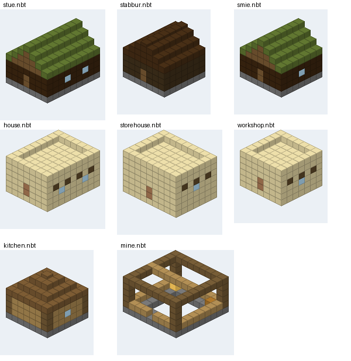
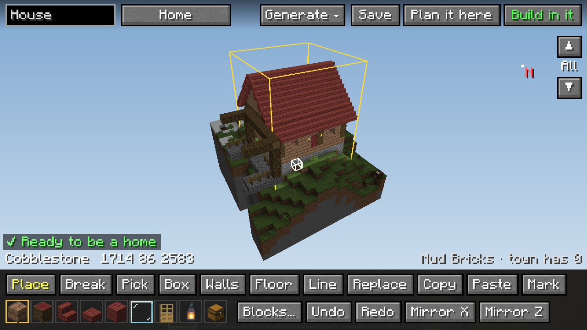
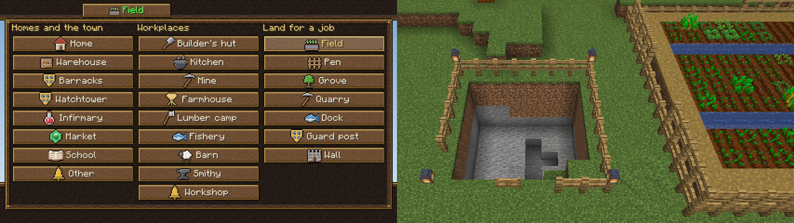
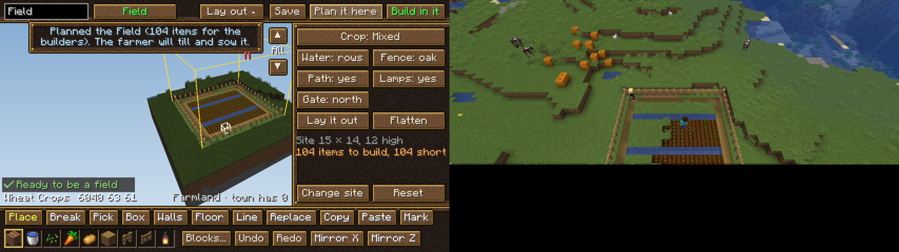
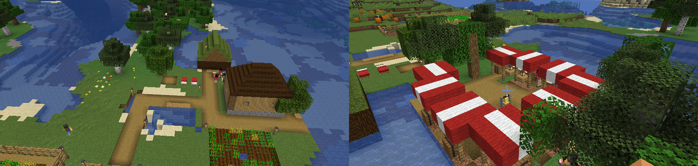

# Stad: a player's guide

## Getting started

1. Install NeoForge 21.1 for Minecraft 1.21.1, then **They Will Talk** (0.3.0-alpha.6 or newer) and **Stad**. On a
   server, both go on the server; players need Stad on their own computer too (for its screens and the building
   previews), and Simple Voice Chat plus Sipher if they want to talk with their voice.
2. The citizens think with a small AI model that runs on your own GPU. Open a world (or start the server), run
   `/twt dashboard`, and click **Install recommended** on the Models page. Until it's installed, citizens live and work
   but don't talk.
3. Craft a **town hall**: three bookshelves on top, planks, a bell and planks in the middle, three planks below. Place
   it where your town's middle should be. Its land reaches 48 blocks round it.

## Your first hour

Right-click the town hall any time: its **Town** tab lists the next steps, ticks off the ones you've done, and says
who can't work and why.

1. **Beds.** Place a bed or two anywhere on the town's land. Newcomers move in every few minutes while there's a free
   bed (the first comes straight away).
2. **A builder.** Right-click a citizen and pick **Builder**. Hover over any job to see what it does and needs; jobs
   your town can't support yet are greyed out and say what's missing.
3. **A house.** Craft **Building Plans** (two paper and a coal) and right-click the ground. Pick a building from the
   tabs (Homes, Workplaces, Town, Fields), turn it with Door, check it with Preview, and Plan it. You're told what to put
   in the town hall. (Or describe a house to your builder: "a small stone cottage with two bedrooms".)
4. **Materials.** Sneak and right-click the town hall (or press Storage on its screen) and put the materials in. The
   builder makes up the ground under the house, builds what they can, and says what's still missing.
5. **Food.** Put some food in the town hall. Make a **farmer**: they mark out a field by their farmhouse or the town
   hall, till it round a water hole they dig, and sow it (put wheat seeds in the town hall, or they pick seeds from
   the grass, slowly). Make a **cook** and place a furnace: three wheat bake a loaf, and cooked food fills far more.
6. **Grow.** More houses for more citizens, workplaces for the workers (a farmhouse, lumber camp, kitchen...), a
   warehouse and a courier, and a guard with a sword.

**When a citizen isn't working**, their card (right-click them) and the town hall's **Citizens** tab say why, and what
would fix it: "No seeds to sow: put wheat seeds in the town hall", "Nowhere to cook: place a furnace...", "Waiting for
23 cobblestone for the Cottage". A problem that lasts is told to you in chat, once a day. They'll tell you if you ask,
too.

## Jobs

| Job | What they do | What they need |
|---|---|---|
| Builder | builds what officers plan, block by block; makes up the ground under it, and builds what it can while it waits for the rest | a planned building, and its materials in the town hall (or a warehouse) |
| Farmer | marks out a field, levels and tills it round a water hole it digs, sows it, harvests and replants | seeds in the town hall (or picked from the grass), and flat grass or dirt |
| Lumberjack | fells natural trees, top down, and replants; plants a grove when there are none | trees on the town's land, or saplings in the town hall |
| Courier | carries food and materials from the warehouse to where they're needed | a warehouse |
| Guard | patrols, fights monsters and raiders | a sword (and armour) in the town's stores |
| Cook | bakes bread from wheat, cooks meat, fish and potatoes, and brings it to the town hall | a furnace, smoker or campfire on the town's land |
| Fisher | fishes from the shore | a pond or river on the town's land (eight blocks of water or more) |
| Shepherd | brings in animals from just outside town, shears sheep, feeds the animals so they breed, butchers the extras, picks up eggs and wool | sheep, cows, pigs or chickens in or near town, and what they eat |
| Miner | digs the town's mine deeper, layer by layer, for stone, coal and ore | a **Mine** from the Medieval pack |
| Smith | makes the tools the workers are short of, mends worn ones, smelts ore | a **smithy** (anvil and furnace) |
| Healer | treats the ill and the wounded | nothing; an **infirmary** gives the ill a bed |
| Merchant | sells the town's spare goods and buys what it needs, for emeralds | nothing; a **market** to stand at |
| Teacher | teaches the town's children | a **school** (a lectern) |
| Carpenter | saws logs into planks and sticks, and makes the doors, fences, stairs and chests the builders ask for | a **sawmill** (a crafting table), logs in the town hall, and an axe |
| Mason | burns cobblestone into stone, cuts stone bricks, slabs and stairs, makes glass from sand | a **stoneworks** (a stonecutter and a furnace), cobblestone or sand, and a pickaxe |
| Weaver | makes wool into beds for new homes, and carpets | a **loom house** (a loom), wool and planks, and shears |
| Beekeeper | brings bees to the hives, sows flowers for them, takes the honey and honeycomb | an **apiary** (beehives among flowers: lay one out at the architect's table), shears, and glass bottles for the honey |

The carpenter, mason and weaver first make whatever the builders are waiting for (a door, stone bricks, a bed for a
new house), then keep the town stocked with the basics: 64 planks and 32 sticks; 32 stone, 64 stone bricks and 16
glass; two beds. Everything goes to the town hall, where the builders look. When the town hall is full they stop and
say so: build a warehouse.

**Workplaces.** Each job works from a building of its own: a **farmhouse** (composter and chest), **lumber camp**
(chest and crafting table), **fishery** (barrel), **barn** (loom and hay bale), the kitchen, the mine, the builder's hut,
the warehouse (couriers) and the barracks or a watchtower (guards). Every pack has the four new ones. Workers move into
the nearest one with room by themselves; tell one "work at the lakeside fishery" to move them. With a workplace they
start the day there, work the land round it, work faster and are happier; without one they grumble.

Workers bring what they gather to the **warehouse** (or the town hall when there's none). Late in the afternoon they
bring the day's work in.

**Skills and tools.** Citizens get better at a job the more they do it, from novice to master (their card shows it).
Farmers, lumberjacks, miners, fishers and shepherds need a real hoe, axe, pickaxe, rod or shears: put some in the town
hall, or get a **smith**, who makes them from what's in the stores, mends worn ones and smelts the miner's ore.
Without a tool a worker makes do, slowly, and the town asks for one.

**Illness.** Now and then someone falls ill and stays in bed for a few days; a **healer** gets them up again sooner.

**Trading.** Put emeralds in the town hall and make someone the **merchant**: players can then sneak and right-click
them to buy the town's spare goods and sell it what it's asking for. **Children** who go to school while there's a
**teacher** grow up quicker to learn.

**Feeding the town.** Wheat only feeds anyone once a cook bakes it (three wheat to a loaf), and cooked food fills a
citizen far more than raw. A farmer and a cook keep a small town fed; add a shepherd, a fisher and a courier as it
grows. The town hall asks for food when it runs low (`/stad colony requests`).

**The shepherd** breeds each kind of animal up to six (`herdSize`) with the town's wheat, carrots and seeds, and
butchers them once there are four more than that. Animals with a name or on a lead are someone's pets and are left
alone.

**The miner** digs a 5x5 shaft under the mine's headframe. One block of each layer stays as a step, each a block
further round the wall, so the steps spiral down and the miner walks to the bottom and back. They put torches on the
wall as they go and wall off any water or lava they break into. A mine stops at 48 layers (`mineDepth`). On a slope,
where the shaft starts above the ground, they put the top steps in first.

## Building

**Building Plans** (two paper and a coal): right-click the ground to choose a building and a style, see where it
goes, and plan it. Builders won't build on open water; they fill in a dip, a slope or a puddle under a building.
**Fields** are in the plans too: a 9 by 9 field round a water hole, which the farmers make (nothing for the builders).
Design bigger ones, pens and groves at the architect's table (below).
**Or talk to your builder**: "a small stone cottage with two bedrooms and a chimney". They draw it
up, a ghost of it appears nearby, and you change it as you talk until you say "build it".

The packs: **Medieval** (timber and cobblestone under hip roofs: cottage, builder's hut, warehouse, kitchen, mine),
**Fjord** (laid log walls on stone footings under turf roofs: stue, stabbur, builder's smie) and **Oasis** (sandstone
with flat roofs and parapets: house, storehouse, workshop). Any building can be built in any of the seven styles.

**The architect's table** (Building Plans on top of a cartography table) lets you design for one exact spot. Mark
two corners with the scan wand and right-click the table with it. You see the site in 3D: drag to turn it, scroll to
zoom, shift+scroll to cut it off at a layer and look inside. Choose what kind of building it is (top left), then build
it block by block (the tools are along the bottom; right-click removes, middle-click picks a block, R turns it, E opens
the block list). To start from a generated building, open **Generate ▾**, pick a style, floors and a roof, and click
**Generate**. The line at the bottom left says what it still needs. **Plan it here** hands it to the builders;
**Save** keeps it for anywhere.

**Build in it** takes you to the drafting world, an empty void with just a copy of the site, to build it yourself in
creative; a grid marks where you can build. Press **B** when you're done and **Keep it**: what you built becomes the design, and you're back at the table
with your own things (nothing there is real, and nothing comes back with you). The builders then build it for real.

**What you design** is chosen from the list behind the kind button (top left): homes and the town's buildings, a
workplace for every job, and **land and roads**:

| Land | For | What it is |
|---|---|---|
| Field | farmer | farmland round water, sown with the crop you choose |
| Pen | shepherd | a fenced yard with a gate, shelter, hay and water |
| Grove | lumberjack | saplings in rows, planted and felled as they grow |
| Quarry | miner | an open pit dug down layer by layer, with steps round the edge |
| Dock | fisher | a pier over the water with spots to fish from (point the door at the shore) |
| Guard post | guard | a platform the guards climb and keep watch from |
| Wall | guard | a palisade or stone wall round the site, with a door and watch spots on the corners |
| Market square | merchant | stalls round a paved square with a bell; a merchant keeps each stall |
| Road | everyone | a paved road, routed for you or drawn by hand; citizens walk faster on it |

For a **field, pen or grove**, open **Lay out ▾**. For a field choose the crop (or mixed), water in rows or holes, a fence, a path and
lamps; for a pen the animals and a shelter; for a grove the trees and how far apart; for a quarry how deep; for a
wall what it's made of and how high; for a market square the awnings, the paving and which side the way in is on.
**Lay it out** fills the site,
and you can change it by hand like a building (the hotbar has farmland, water, crops, fences and saplings). Plan it:
the builders level it and put up the fence, and then the farmer tills and sows it, the shepherd leads the animals in
through the gate, or the lumberjack plants the saplings (put seeds, carrots, potatoes or saplings in the town hall).

**Roads.** The quickest way: the town hall's **Buildings** tab has **Lay roads**, which joins every door and gate in
town (and the hall) with roads for the builders, over all of the town's land. Press it again whenever you've built more.
For a road of your own, mark a site (any size, on the town's land) over the stretch it should run along and choose
**Road**: the table
joins up the doors and gates of the buildings in it, the town hall and any path that runs up to its edge, the easiest
way over the land (**Route it** again after you change something). Or draw it with the **Road** tool: click along the
ground, and each click draws on from the last; right-click to stop, or to take the road off a block. Choose the paving,
how wide it is and lamp posts, then plan it. A road stops at buildings and only paves the ground. Citizens walk about
a third faster on the town's roads, so join the busy places up: the town hall, the warehouse, the fields and the
market. Roads from different sites join where they meet.

Built a house yourself? Stand in it and tell a citizen "this is your home now". The **scan wand** (an amethyst shard
on top of two sticks) saves your buildings into **My pack**.

## Leading

Every order is checked against your rank and the citizen's opinion of you. Your **standing** with the town rises when
they're fed, housed, safe and treated well, and falls when they go hungry, get hurt or are let down
(`/stad colony standing` says why). A respected leader is obeyed; a doubted one gets slow, grudging work; a resented
one hears "no", with a reason, or "only once I've eaten". Miserable citizens leave, and an unhappy town goes on strike.

## Raids

Bigger towns get raided now and then at dusk. Who comes depends on the land round the town hall:

| Faction | Where | Look |
|---|---|---|
| Norse raiders | taiga, snowy and cold lands | iron helmets, axes, the leader with a shield |
| Marauders | deserts, badlands, savanna | sand-coloured leathers, golden swords and bows |
| Bandits | everywhere else (or pillagers) | dark leathers, swords and bows |
| Pillagers | everywhere else (or bandits) | the game's own, with vindicators on hard |

Every raid but the pillagers' has a named leader, tougher and better armoured than the rest. A citizen spots them and
shouts which way they're coming; guards take swords and armour from the town's stores and fight; everyone else
shelters indoors, or runs to the far side of town when there's nowhere to hide. Afterwards the builders repair the
damage, and everyone remembers who fought.

Two guards with iron swords should see off a first raid. Build barracks and watchtowers as the town grows, keep spare
swords in the town hall, and give guards houses near the edge the raiders come from.

Wars between players' towns are opt-in for each town; see the README.

## Settings

`config/stad-common.toml` (and They Will Talk's own `config/theywilltalk-common.toml`). The ones you're most likely to
change:

| Setting | Default | |
|---|---|---|
| `colonies.claimRadius` | 48 | how far a town's land reaches |
| `colonies.arrivalMinutes` | 5 | minutes between newcomers |
| `colonies.leadership` | NORMAL | LOYAL (they always obey), NORMAL, HARSH |
| `jobs.herdSize` | 6 | animals of each kind the shepherd keeps |
| `jobs.mineDepth` | 48 | layers a mine goes down |
| `needs.illnessChance` | 0.03 | chance each morning that a citizen falls ill (0: never) |
| `raids.mobRaids` | NORMAL | OFF, EASY, NORMAL, HARD |
| `raids.pvpRaids` | OPT_IN | OFF, OPT_IN, FORCED |
| `thinking.thinkRadius` | 48 | citizens this close to a player plan their day with the AI |
| `performance.keepLoaded` | WHILE_ONLINE | NEVER, WHILE_ONLINE, ALWAYS |
| `raids.raiderFactions` | true | off: always pillagers |
| `raids.maxRaiders` | 16 | the most raiders in one raid |
